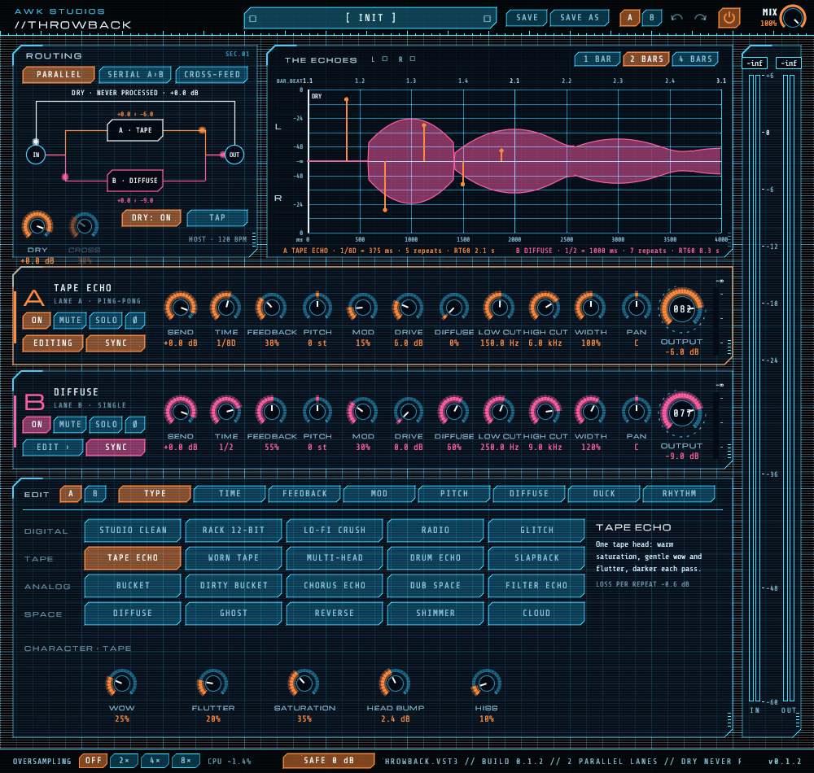

# THROWBACK

**Two-lane parallel delay with 20 echo types. The dry signal is never processed.**



THROWBACK runs two delay lanes, A and B, next to an untouched dry path. Route them in parallel, in series or cross-fed, pick an echo type for each lane and watch every repeat on THE ECHOES display.

## Features

- **20 echo types** in four families: digital, tape, analog and space (tape echo, multi-head, bucket brigade, dub, shimmer, granular cloud and more).
- **Routing:** PARALLEL, SERIAL A›B or CROSS-FEED.
- **Per lane:** sync or free time, feedback, modulation, pitch, diffusion, ducking, filters, 16-step rhythm, freeze.
- **TAP** tempo, DRY on/off for send/return use, and MIX that only scales the lanes.
- Zero latency.
- 28 factory presets.

## Install

Windows 64-bit, VST3. Built and tested in FL Studio.

1. Download `ThrowBack-v0.1.3-win64.zip` from [Releases](../../releases/latest).
2. Copy `ThrowBack.vst3` into `C:\Program Files\Common Files\VST3\`.
3. Copy the files in `presets` into `Documents\Awknode\Presets\ThrowBack\` (create the folder if it doesn't exist).
4. Rescan plugins in your DAW.

## Using it

Every awk studios plugin has the same top strip: preset browser, A/B, undo/redo, power (bypass) and a global MIX. Knobs drag up and down (hold Ctrl or Shift for fine control), scroll to nudge, and double-click to reset. **SAFE** in the footer is an output limiter that keeps the plugin from going over 0 dBFS; it's on by default.

The full control reference is in the **[manual](docs/MANUAL.md)**.

## Build from source

You'll need Docker. Clone this repo next to the [nih-plug-awk](https://github.com/awknode/nih-plug-awk) framework fork, then run the build script:

```sh
git clone https://github.com/awknode/throwback
git clone -b awk-studios https://github.com/awknode/nih-plug-awk
cd throwback && ./build.sh
```

The plugin lands in `target/bundled/ThrowBack.vst3`.

## License

GPL-3.0. See [LICENSE](LICENSE). Built with [nih-plug](https://github.com/robbert-vdh/nih-plug).

---

More awk studios plugins: [VISE](https://github.com/awknode/vise) · [SALVE](https://github.com/awknode/salve) · [HOIST](https://github.com/awknode/hoist) · [KILN](https://github.com/awknode/kiln) · [PATINA](https://github.com/awknode/patina) · [CHOPSHOP](https://github.com/awknode/chopshop) · [THROW FX](https://github.com/awknode/throw-fx) · [KICKNULL](https://github.com/awknode/kicknull) · [ALLEYVERB](https://github.com/awknode/alleyverb) · [WAVETAG](https://github.com/awknode/wavetag)
